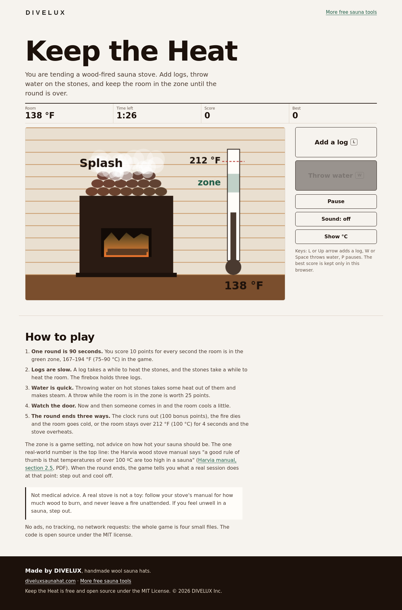
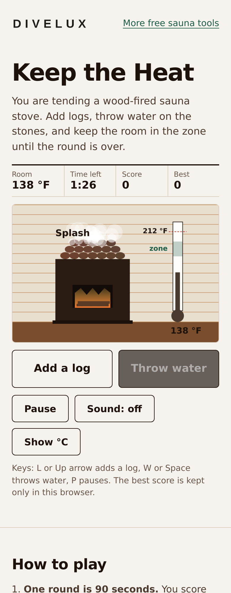

# Keep the Heat

A tiny browser game about tending a wood-fired sauna stove. Add logs, throw water on the stones, and keep the room in the zone for one 90-second round. Plays on a phone or a desktop, with no sign-up, no ads and no network requests.

Made by [DIVELUX](https://diveluxsaunahat.com), a small family brand in Irvine, California that makes handmade wool sauna hats.





## How to play

- **One round is 90 seconds.** 10 points for every second the room is in the green zone (167–194 °F, 75–90 °C in the game).
- **Add a log** (button, `L` or Up arrow). Logs are slow: the fire heats the stones, the stones heat the room. The firebox holds three logs.
- **Throw water** (button, `W` or Space). Water on hot stones takes heat out of them and makes steam. A throw while the room is in the zone is worth 25 points.
- **Watch the door.** Now and then someone comes in and the room cools a little.
- **Endings:** the clock runs out (+100 points, and the game tells you to go and cool off), the fire dies and the room goes cold, or the room stays over 212 °F (100 °C) for 4 seconds and the stove overheats.
- `P` or Escape pauses. The game pauses itself when you switch tabs.

The green zone is a game setting, not advice on how hot a sauna should be. The one real-world number is the overheat line: the Harvia wood stove manual says "a good rule of thumb is that temperatures of over 100 ºC are too high in a sauna" ([Harvia manual, section 2.5](https://saunamarketplace.com/wp-content/uploads/2022/11/Harvia-M3-Manual.pdf), PDF). The stove model is a toy, not physics.

> Not medical advice. A real stove is not a toy: follow your stove's manual for how much wood to burn, and never leave a fire unattended.

## Built to be gentle

- **Sound is off** until you press "Sound: on". The tones are generated in the browser; there are no audio files.
- **Reduced motion:** with `prefers-reduced-motion`, the flames stop flickering and the steam is a still haze instead of moving puffs.
- **Touch:** big buttons (64 px tall on phones), `touch-action: manipulation` so quick taps do not zoom.
- **Screen readers:** the score, time and temperature are real text; zone changes, door events and the end of the round are announced in a polite live region; every control is a real button.
- **Privacy:** the best score is kept in `localStorage` on your device only, under `divelux-keep-the-heat-best`. If storage is blocked, the game still works.
- **No network:** no web fonts, no analytics, no CDN. The page loads `style.css`, `game.js`, `app.js` and two images.

## Run it

Open `index.html` in a browser, or serve the folder:

```sh
python3 -m http.server 8000
```

To publish on GitHub Pages: Settings → Pages → Deploy from a branch → `main` / root. The `.nojekyll` file is already here. For itch.io, zip the folder with `index.html` at the root and choose "HTML".

## Files

| File | What it is |
| --- | --- |
| `index.html` | The page: HUD, canvas, controls, how to play, footer |
| `style.css` | All styles. Every class starts with `dvx-` or `kth-` |
| `game.js` | The game rules: pure functions, a seeded random generator, no DOM, no clock. Works in Node |
| `app.js` | Canvas drawing, controls, keyboard, sound, best score |
| `test.js` | Checks the rules: each ending is reachable, careful play wins, the firebox cap, cooldowns, the 4-second overheat, replay with the same seed, storage that never throws, no network APIs |

```sh
node test.js
```

Tweak the game in `CFG` at the top of `game.js` (round length, zone, burn rate, cooldowns, points).

## License

MIT, © 2026 DIVELUX Inc. See [LICENSE](LICENSE).

Made by [DIVELUX](https://diveluxsaunahat.com), handmade wool sauna hats. More free sauna tools: <https://diveluxsaunahat.com/pages/sauna-tools>
